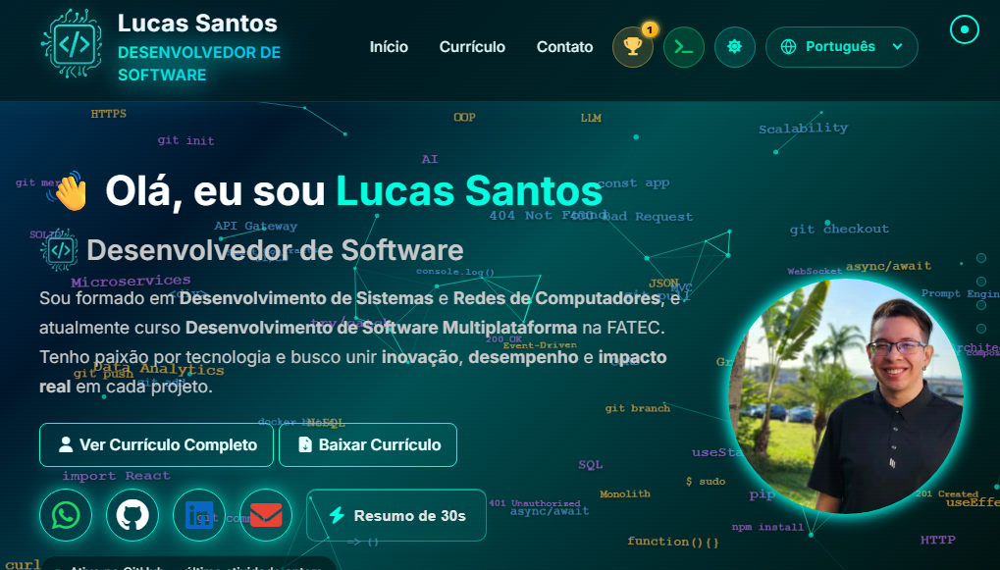

<div align="center">

# Lucas Santos — Portfólio

**Portfólio e currículo interativos de um desenvolvedor de software**, feitos com Astro e TypeScript.
Rápido, acessível e com alguns segredos escondidos.

[**lucastec.vercel.app**](https://lucastec.vercel.app) · [Currículo](https://lucastec.vercel.app/curriculo.html)





## 🚀 Sobre o projeto

Este é o meu cartão de visitas na web: apresenta quem eu sou, minhas tecnologias, os projetos que construí e o currículo completo, tudo numa experiência pensada para ser lembrada, sem abrir mão de desempenho nem de acessibilidade.

Sou formado em **Desenvolvimento de Sistemas e Redes de Computadores** e curso **Desenvolvimento de Software Multiplataforma** na FATEC. O site nasceu em HTML/CSS/JS puros e foi migrado para **Astro + TypeScript** para ficar mais rápido, tipado e fácil de manter.

<div align="center">


## ✨ Destaques

|                                        |                                                                                                                               |
| -------------------------------------- | ----------------------------------------------------------------------------------------------------------------------------- |
| 🌗 **Tema escuro/claro**               | Abertura cinematográfica, que pode ser pulada com um toque ou tecla                                                           |
| 💻 **Terminal interativo**             | Digite `ajuda` para ver os comandos (`sobre`, `skills`, `projetos`, `experiencia`, `contato`, `curriculo`, `github`, `tema`…) |
| 🏆 **Conquistas e XP**                 | 10 conquistas (6 abertas + 4 secretas) liberadas ao explorar o site                                                           |
| 🧭 **Tour guiado**                     | Na home e no currículo, mais o **"Resumo de 30 s"** para quem tem pressa                                                      |
| 🐙 **Atividade do GitHub**             | Ao vivo, com modal de estatísticas do perfil                                                                                  |
| 📊 **Radar de competências**           | Chart.js, análise **SWOT** e linha do tempo no currículo                                                                      |
| 🔗 **Skills ↔ Projetos**               | Clicar numa tecnologia destaca os projetos que a usam                                                                         |
| 📬 **Formulário de contato acessível** | Validação, rascunho automático e envio real pelo **Formspree**                                                                |
| 🌍 **Tradução PT / EN / ES**           | Pelo [GTranslate](https://gtranslate.io) (versão gratuita), com cursor personalizado                                          |
| 🥚 **Segredos escondidos**             | Boa caçada                                                                                                                    |


## 🔎 Projetos em destaque

| Projeto              | O que é                                   |
| -------------------- | ----------------------------------------- |
| **Planet Spotter**   | NASA Space Apps Challenge                 |
| **Janosys API**      | Projeto acadêmico, FATEC                  |
| **Tempero da Casa**  | Cardápio digital                          |
| **CodeWave**         | Site de empresa de tecnologia             |
| **TaskMaster**       | Gerenciador de tarefas                    |
| **Portfólio Gamer**  | Experiência interativa em RPG             |
| **Aerocode**         | Sistema de gestão da produção aeronáutica |
| **Vinícola Premium** | Experiência digital sofisticada           |
| **Signa**            | Gestão de requisitos aeronáuticos         |


## ⚙️ Stack

Clique em uma categoria para expandir.

<details open>
<summary><b>🎨 Frontend & UI</b></summary>

      

</details>

<details>
<summary><b>📬 Formulário & Métricas</b></summary>

  

</details>

<details>
<summary><b>🧪 Testes & Qualidade</b></summary>

       

</details>

<details>
<summary><b>☁️ Deploy, CI & Segurança</b></summary>

        

</details>

<details>
<summary><b>📋 Detalhes técnicos por camada</b></summary>

<br>

| Camada             | Tecnologias                                                                                                                                                                                |
| ------------------ | ------------------------------------------------------------------------------------------------------------------------------------------------------------------------------------------ |
| **Framework**      | [Astro 7](https://astro.build) (site estático) · `build.format: "file"` mantém `/curriculo.html`                                                                                           |
| **Linguagem**      | TypeScript 6 (`strict`) · Node.js ≥ 26.13                                                                                                                                                  |
| **UI**             | CSS modular (36 módulos) · Swiper 14 (só Navigation/Autoplay) · Chart.js 4.6 (só o radar) · Font Awesome 7 (subconjunto gerado) · badges gerados no build (`badge-maker` + `simple-icons`) |
| **Imagens**        | `astro:assets` (AVIF/WebP responsivos)                                                                                                                                                     |
| **Formulário**     | [Formspree](https://formspree.io) via `PUBLIC_CONTACT_ENDPOINT` (sem a variável, abre o app de e-mail)                                                                                     |
| **Qualidade**      | ESLint 10 + `typescript-eslint` + `eslint-plugin-astro` + `jsx-a11y` (a11y) · Prettier 3.10 · Stylelint 18 · CSpell 10 (PT-BR + EN) · Knip 6 · `astro check`                               |
| **Testes**         | Vitest 5 + happy-dom (unitários e integridade dos dados) · Playwright 1.65 + axe (E2E e acessibilidade) · Lighthouse CI · Linkinator (links) · size-limit (orçamento de tamanho)           |
| **CI / Segurança** | GitHub Actions (actions fixadas por SHA) · CodeQL · zizmor · OSV-Scanner · Gitleaks · OpenSSF Scorecard · Dependabot · Husky + lint-staged (hook de commit)                                |
| **SEO / Métricas** | `@astrojs/sitemap` · canonical, Open Graph, Twitter Cards, JSON-LD · `web-vitals` 6 · Vercel Speed Insights                                                                                |
| **Deploy**         | [Vercel](https://vercel.com)                                                                                                                                                               |

</details>


## ⚡ Desempenho

| ⚡ Transferência                                                                             | 🎯 Estabilidade                 | 🚀 Velocidade                                                 |
| -------------------------------------------------------------------------------------------- | ------------------------------- | ------------------------------------------------------------- |
| De **6,9 MB** para **~480 KB**<br>(já com fonte e badges locais)<br>JS de 131 para **17 KB** | **CLS** de 0,135 para **0,002** | **LCP** de 15,8 s para **2,4 s**<br>Lighthouse desktop **98** |

Medição de laboratório (Lighthouse 13, mobile simulado, home). A metodologia, as limitações e o que ficou de fora estão em [`docs/performance.md`](docs/performance.md).


## 🧑‍💻 Como rodar

Requer **Node.js ≥ 26.13.0** (o mesmo major usado no CI).

```bash
npm install
npm run dev        # http://localhost:4321
```

<details>
<summary><b>📜 Comandos disponíveis</b></summary>

<br>

| Comando                                         | O que faz                                                            |
| ----------------------------------------------- | -------------------------------------------------------------------- |
| `npm run build`                                 | Gera os ícones, checa tipos (`astro check`) e cria `dist/`           |
| `npm run preview`                               | Serve o build localmente                                             |
| `npm run check`                                 | Só a checagem de tipos (`astro check`)                               |
| `npm run lint` · `lint:fix`                     | ESLint                                                               |
| `npm run lint:css` · `lint:css:fix`             | Stylelint (com teto de avisos que só pode diminuir)                  |
| `npm run format` · `format:check`               | Prettier                                                             |
| `npm run spell`                                 | CSpell (inglês + português)                                          |
| `npm run knip`                                  | Código, exports e dependências não usados                            |
| `npm run test` · `test:watch` · `test:coverage` | Vitest (unitários, DOM e integridade dos dados)                      |
| `npm run test:e2e`                              | Testes E2E, de acessibilidade (axe), SEO e segurança (Playwright)    |
| `npm run test:report` · `test:report:all`       | Gera relatório Markdown da suíte Vitest em `reports/`               |
| `npm run size`                                  | Orçamento de tamanho do build, em gzip (size-limit)                  |
| `npm run check:links`                           | Links internos e âncoras do `dist/` (Linkinator)                     |
| `npm run check:links:live`                      | Links do site publicado, inclusive externos (Linkinator)             |
| `npm run analyze`                               | Treemap do bundle em `.sonda/sonda.html` (Sonda)                     |
| `npm run quality`                               | Lint, CSS, formatação, tipos, testes, Knip e CSpell de uma vez       |
| `npm run icons`                                 | Regenera o subconjunto do Font Awesome (automático no `dev`/`build`) |

O `npm install` ativa o hook de commit (Husky + lint-staged), que roda ESLint, Stylelint, Prettier e CSpell só nos arquivos alterados.

Os testes unitários incluem verificações do gerenciamento de diálogos (foco, `inert` e restauração do acionador) e da renderização segura das notificações de conquistas. Conteúdo dinâmico textual nesses componentes é inserido com `textContent`, sem ser interpretado como HTML.

`npm run test:report` gera `reports/relatorio-testes.md`; `npm run test:report:all` solicita a execução ampliada prevista pelo script. O relatório é um artefato local de execução e não deve ser tratado como evidência atual depois de mudanças no código. A cobertura deve ser consultada após uma execução recente de `npm run test:coverage`.

</details>

<details>
<summary><b>🔐 Variáveis de ambiente (opcionais, veja <code>.env.example</code>)</b></summary>

<br>

| Variável                  | Efeito                                                                                                                                                          |
| ------------------------- | --------------------------------------------------------------------------------------------------------------------------------------------------------------- |
| `PUBLIC_CONTACT_ENDPOINT` | URL do formulário no **Formspree** (`https://formspree.io/f/<id>`), que recebe o envio via `POST` JSON. Sem ela, o formulário abre o app de e-mail (`mailto:`). |
| `PUBLIC_VITALS_URL`       | Endpoint que recebe Core Web Vitals reais via `sendBeacon`.                                                                                                     |

Passo a passo do Formspree e contrato dos endpoints: [`docs/configuration.md`](docs/configuration.md).
Cabeçalhos HTTP, CSP e passos no GitHub: [`docs/security.md`](docs/security.md).

</details>


## 🗂️ Estrutura

<details>
<summary><b>Árvore de pastas</b></summary>

```
public/                 favicons, manifest, imagem social (og-image.jpg), QR Code, PDF do currículo, robots.txt
scripts/fa-subset.mjs   gera o subconjunto do Font Awesome a partir dos ícones usados no código
src/
  assets/               imagens e fontes processadas pelo Astro
  components/           Hero, Skills, Projects, Swot, Contact, Header, Footer, modais…
  data/                 ← edite aqui: projects.ts, skills.ts, site.ts
  layouts/Base.astro    <head> (SEO, JSON-LD), tema, estilos
  lib/badges.ts         gera os badges de tecnologias (SVG) no build → /badges/*.svg
  pages/                index.astro · curriculo.astro
  styles/               index.css importa 36 módulos na ordem original (a cascata depende dela)
  scripts/
    main.ts             entrada: decide O QUE carrega e QUANDO
    deferred.ts         tudo que não é crítico (carregado em ociosidade)
    core/ features/ effects/ data/   (core/storage.ts: acesso seguro a localStorage/sessionStorage)
src/**/*.test.ts        testes unitários (Vitest), ao lado do código; inclui core/dialog e features/achievements
tests/                  E2E (Playwright), acessibilidade (axe), SEO, segurança (CSP), tradução e formulário
reports/                relatórios Markdown gerados localmente pelos scripts de teste
docs/                   preview, desempenho, segurança (CSP, GitHub) e configuração (endpoints)
.github/                CI, CodeQL, zizmor, OSV-Scanner, Gitleaks, Scorecard e Dependabot
*.config.* · knip.json · cspell.json · .size-limit.json · linkinator*.json
                        configuração das ferramentas de qualidade
```

</details>

**Estratégia de carregamento**

1. **Crítico** (`main.ts`): tema, cursor, revelar ao rolar, abertura, navegação.
2. **Ocioso** (`deferred.ts`): efeitos, conquistas, GitHub, tradução, tour…
3. **Perto da tela**: carrossel (Swiper), constelação de skills, gráfico SWOT (Chart.js).
4. **No clique**: terminal, resumo de 30 s e formulário de e-mail (envio ao Formspree).


## ➕ Adicionando conteúdo

- **Projeto novo**: acrescente um objeto em `src/data/projects.ts` (imagem em `src/assets/img/`). O campo `tech` usa os mesmos identificadores das skills (tipo `TechId`).
- **Tecnologia nova**: acrescente `{ alt, color, logo }` em `src/data/skills.ts` (o badge é gerado no build; `logo` é o slug do [simple-icons](https://simpleicons.org)). Esse arquivo é a **fonte única**: o badge aparece sozinho na home e no currículo (componente `SkillBadges.astro`).
- **Contadores** do hero (projetos e tecnologias) e o total de conquistas/XP são **derivados dos dados**, nada para atualizar à mão.
- **Ícone novo**: escreva a classe (`fa-solid fa-rocket`) no código; o subconjunto é regenerado sozinho.

## ♿ Acessibilidade e SEO

- Auditado com **axe-core** em Chromium real (claro e escuro, diálogos abertos): zero violações de contraste no tema escuro (padrão) nas duas páginas e Lighthouse de acessibilidade **100** no desktop.
- Foco visível, link "Pular para o conteúdo", diálogos com fundo `inert`, **Esc** e retorno de foco, `prefers-reduced-motion` respeitado.
- `canonical`, Open Graph (imagem 1200×630), Twitter Cards, **JSON-LD** (`Person`/`WebSite`/`WebPage`), `sitemap-index.xml` e `robots.txt`.


## 🧠 Decisões técnicas

<details>
<summary><b>Ver as decisões e o porquê de cada uma</b></summary>

<br>

- **TypeScript 6, não 7**: o `typescript-eslint` e o `@astrojs/check` (e o editor) ainda dependem da API em JS do compilador, que o TS 7 nativo não tem. Migrar quando o ecossistema acompanhar.
- **Formspree para o formulário**: o site é estático e não tem backend próprio. O Formspree recebe o `POST` JSON, e a origem `https://formspree.io` já está liberada em `connect-src` na CSP do `vercel.json`. A URL do formulário fica no JavaScript do navegador (é pública por natureza), então a proteção contra spam fica no painel do Formspree. Detalhes em [`docs/configuration.md`](docs/configuration.md).
- **GTranslate no lugar do Google Tradutor**: o Google encerrou o _Website Translator Widget_ em 1/out/2026. O [GTranslate](https://gtranslate.io) gratuito (`core/translate.ts`) traduz no navegador, sem indexação das traduções, e é gratuito para sites pessoais/sem fins comerciais. Carrega em ociosidade e, se for bloqueado, o espaço reservado some.
- **Seletor de idioma personalizado**: o widget "Dropdown" do GTranslate gera um `<select class="gt_selector">`, que fica na página só como **motor** (invisível). A interface é um dropdown próprio (`features/language-switcher.ts` + `styles/components/language-switcher.css`) com só **PT / EN / ES** e navegação por teclado (padrão WAI-ARIA de listbox). Ao escolher, o código atribui o valor no `<select>` e dispara `change`, o que aciona a tradução. Para mudar os idiomas, edite `LANGS` no `.ts` e `languages` em `core/translate.ts`.
- **`compressHTML: false`**: a compressão padrão do Astro remove espaços entre tags inline e cola ícones ao texto.
- **CSS cortado em sequência, sem reordenar**: preserva a cascata do CSS original.
- **Font Awesome em subconjunto**: 87 ícones custam ~10 KB; SVGs inline custariam ~38 KB (medição em [`docs/performance.md`](docs/performance.md)).
- **Chart.js só com o radar**: `chart.js/auto` registra todos os tipos de gráfico; o site registra apenas radar, escala radial, ponto, linha, _filler_ e tooltip (~21 % menor em gzip). Um teste unitário monta o gráfico e falha se faltar algum registro.
- **Sonda pelo plugin do Vite**: o `sonda/astro` não dispara no Astro 7 (o hook de build só roda com `target: "server"`), então o relatório usa `sonda/vite`, ligado só com `npm run analyze`.
- **Stylelint com teto de avisos**: o CSS legado tem avisos que não valem uma reescrita; `lint:css --max-warnings` impede que entrem novos e o teto só desce.
- **Supply chain**: actions fixadas por SHA, Dependabot com espera de 7 dias para versões novas, e zizmor, OSV-Scanner, Gitleaks e Scorecard no CI (detalhes em [`docs/security.md`](docs/security.md)).

</details>

## 🔭 Próximos passos

- Coletar Core Web Vitals reais (`PUBLIC_VITALS_URL`) e ajustar os limites do Lighthouse CI.
- Investigar o Speed Index da home em dispositivo real (abertura e animações contínuas).
- Baixar o teto do `lint:css` (hoje 50 avisos) conforme o CSS for limpo.
- Avaliar trocar o Swiper por CSS `scroll-snap` (o chunk do carrossel é o maior depois do gráfico).

## 🙏 Créditos

Fonte **Inter** (SIL OFL 1.1, `src/assets/fonts/INTER-LICENSE.txt`) · **Font Awesome Free** (CC BY 4.0 / OFL / MIT) · logos dos badges: [simple-icons](https://simpleicons.org) (CC0) e Font Awesome.

## 📄 Licença

Ainda não há um arquivo `LICENSE`; por padrão, todos os direitos ficam reservados ao autor. Para permitir reuso do código, adicione uma licença (ex.: MIT).


## 🤝 Vamos conversar?

<div align="center">


</div>
</div>
</div>
